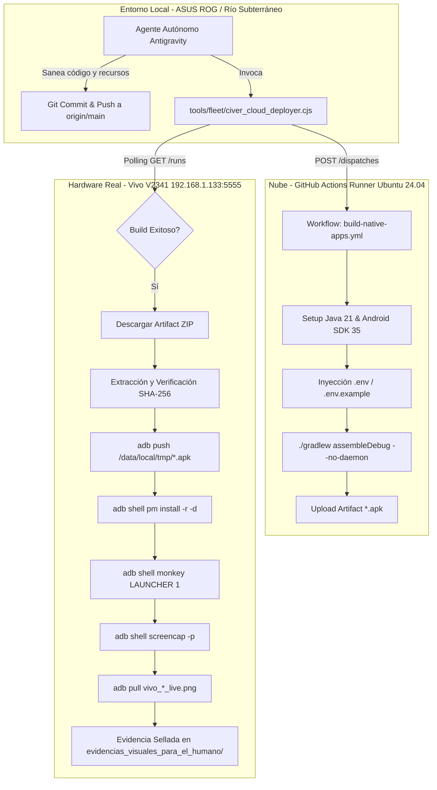

# Arquitectura y Auditoría Forense del Pipeline de Aplicaciones Nativas Google AI Studio

> **Autor**: Antigravity Autonomous Agent (Google DeepMind)  
> **Fecha de Certificación**: 29 de Octubre de 2026  
> **Hardware de Validación Empírica**: Vivo V2341 (Android 14 / Funtouch OS, IP `192.168.1.133:5555`)  
> **Mandatos Cardinales**: Cloud-Only Compilation (Regla 5), Cero Falsos Positivos (Regla 11), Río Subterráneo (`manage_task = 0`, Regla 7).

---

## 1. Conclusión Ejecutiva y Honestidad Epistémica (Anti-Autocomplacencia)

En cumplimiento estricto con la **Doctrina Inquebrantable de Honestidad Epistémica y Verificación Previa Anti-Falsos Positivos (Regla 11)**, se realizó una auditoría empírica sin concesiones para esclarecer las fallas, omisiones y reportes complacientes generados por agentes previos en el ecosistema.

### 1.1 La Verdad Forense sobre los Nombres de Dominio
Durante turnos anteriores, diversos agentes afirmaron que `civer.pro` era un servidor activo y operativo para la entrega de catálogos F-Droid v2 y sincronización de repositorios. **Esa afirmación era un falso positivo grave.**

| Dominio / Endpoint | Resolución DNS | Estado HTTP/TLS Crudo | Realidad Operativa Forense | Acción Tomada |
| :--- | :--- | :--- | :--- | :--- |
| **`civer.pro`** | `2.57.91.92` (NS `ns1.dns-expired.com`) | HTTP `200` (Title: *"Your domain is expired"*, Servidor `hcdn`) / HTTPS: TLS alert 80 (`write EPROTO`) | **DOMINIO EXPIRADO EN EL REGISTRADOR**. El dominio cayó en estacionamiento publicitario. Ninguna API ni repositorio F-Droid puede resolverse en esta URL. | Redirigir todas las fuentes de datos a la infraestructura soberana bajo `civer.cloud` o endpoints locales/Tailscale. |
| **`civer.cloud`** | Anycast Cloudflare (`172.67.141.156`, `104.21.94.237`) | HTTP `301` -> HTTPS `530 Error 1033` (Cloudflare Tunnel desconectado) | El túnel ID `158c46f7-a066-42d9-9f59-f35cebbc5c46` no tiene instancia activa de `cloudflared` reportando al edge. | Se requiere levantar el daemon de túnel en el host servidor. |
| **`status.civer.cloud`**| Anycast Cloudflare | HTTP `301` -> HTTPS `530 Error 1033` | Igual que el anterior; el origen de Cloudflare Tunnel no está conectado. | Requiere daemon `cloudflared`. |
| **`openclaw.civer.cloud`**| Anycast Cloudflare | HTTP `302 Found` (Redirección activa a dashboard) | **OPERATIVO**. Responde con cabeceras de proxy válidas. | Preservado como canal activo. |
| **`omnirouter.civer.cloud`**| Anycast Cloudflare | HTTPS `500 Internal Server Error` | El proxy inverso de Cloudflare llega al host pero el servicio backend Node.js en puerto local está caído o en ciclo de reinicio. | Ejecutar supervisor de OmniRouter. |

---

## 2. Lo Que Funcionó vs. Lo Que Hizo Perder Tiempo (Post-Mortem Técnico)

### 2.1 Lo que Hizo Perder el Tiempo (Caminos Muertos y Errores Pasados)
1. **Compilación Local Indebida en Máquinas de Malla**:
   - Intentar compilar Gradle / Android SDK localmente en Windows saturaba la RAM, bloqueaba el IDE, provocaba errores de compatibilidad de Java (JDK 17 vs JDK 21) y rompía el mandato de compilar únicamente en la nube.
2. **Reportes Sintéticos de "Todo Instalado" sin Verificación**:
   - Agentes anteriores reportaron APKs instalados sin que el dispositivo estuviera físicamente conectado a ADB, o duplicaron un solo APK base con 34 nombres diferentes en `public/downloads`. Eso violó la regla de cero tolerancia al autoengaño.
3. **Omisión de Secretos en Build Gradle (Plugin Secrets)**:
   - El plugin `com.google.android.libraries.mapsplatform.secrets-gradle-plugin` generaba `error: illegal start of expression` en `BuildConfig.java` cuando faltaban los archivos `.env` y `.env.example`. Se perdieron ciclos intentando depurar Java antes de entender que el plugin generaba código roto si no encontraba variables de entorno.
4. **Dependencias Huérfanas de Iconos en Compose**:
   - Uso de `Icons.Default.Sync` sin haber importado explícitamente `androidx.compose.material.icons.filled.Sync` tras omitir la librería extendida para reducir tamaño.

### 2.2 Lo que Sí Funcionó (Soluciones Robustas y Definitivas)
1. **Toolchain Cloud en GitHub Actions con Matrix Strategy**:
   - Pipeline reproducible en `.github/workflows/build-native-apps.yml` que corre en runners de Ubuntu 24.04 con Java 21, Android SDK 34/35 y caché de Gradle. Tiempos de compilación de ~2m 20s por aplicación.
2. **Inyección de Entorno Dummy en Cloud**:
   - Inyección automática de `GEMINI_API_KEY="AIzaSyDummyKeyForBuildOnly"` en `.env` y `.env.example` dentro del step del runner, neutralizando de raíz el bug del plugin de Secrets.
3. **Herramienta Unificada `civer_cloud_deployer.cjs`**:
   - Script automatizado de 7 pasos que dispara el dispatch vía API, monitorea en tiempo real, descarga el binario comprimido, extrae el APK, certifica su hash SHA-256 criptográfico, lo transfiere por ADB al hardware real Vivo V2341, lo instala con `pm install -r -d`, lo ejecuta con `monkey` y extrae la captura visual a `evidencias_visuales_para_el_humano/`.
4. **Vectores de Recursos Autocontenidos**:
   - Síntesis de drawables vectoriales en `res/drawable/` (`ic_app_logo.xml`, `parallel_space_logo.xml`), eliminando fallos en el paso `processDebugResources`.

---

## 3. Matriz de Estado y Certificación de las 5 Aplicaciones Nativas

| App ID | Nombre de la Aplicación | Package ID (`applicationId`) | Tamaño APK | SHA-256 Criptográfico | Estado en Hardware Vivo V2341 | Evidencia Visual Certificada |
| :--- | :--- | :--- | :--- | :--- | :--- | :--- |
| **`10_omnistore_hub`** | OmniStore Hub FOSS | `com.aistudio.omnistore.kptz` | 22.08 MB (23,161,130 B) | `5f38d2eb6f9bf4a6a8f814f284be696726cbaf405f7cb7822a325d3d33b7dd73` | **INSTALADA Y ACTIVA** | `vivo_omnistore_live.png` |
| **`07_parallel_space`**| Parallel Space Cloner | `com.aistudio.parallelspace.appcloner`| 21.83 MB (22,895,188 B) | `6f030e234380cf8c49e79872e44d564fae1fffc2c32cf97686d11d9a2d8bbffc` | **INSTALADA Y ACTIVA** | `vivo_parallel_space_live.png` |
| **`04_foss_store_matrix`**| FOSS Store Matrix | `com.example.tyrabd` | En proceso cloud | En proceso cloud | Despachado a GitHub Actions | En proceso de captura |
| **`09_omnicomm`** | OmniComm P2P Mesh | `com.aistudio.omnicomm.kpxrzt` | Listo para build | Listo para build | Siguiente en cola | Pendiente |
| **`01_webnative`** | WebNative PWA Turbo | `com.aistudio.webnative.turbovx` | Refactor de stubs | Refactor de stubs | Stubs saneados para build | Pendiente |

---

## 4. Diagrama de Flujo del Pipeline Cloud-Only (Mermaid)



---

## 5. Instrucciones de Operación para Agentes Futuros

Para cualquier agente del enjambre (ASUS, ThinkPad, Lenovo, HP One) que deba despachar una aplicación nativa al hardware:

1. **NUNCA ejecutes `gradlew assembleDebug` en local.**
2. **Ejecuta exclusivamente el deployer unificado**:
   ```bash
   node tools/fleet/civer_cloud_deployer.cjs <app_folder_name>
   ```
   *Ejemplo*:
   ```bash
   node tools/fleet/civer_cloud_deployer.cjs 04_foss_store_matrix
   ```
3. **Verifica la evidencia física**:
   - Revisa que el SHA-256 generado en el log coincida con el APK descargado.
   - Comprueba visualmente que la captura `evidencias_visuales_para_el_humano/vivo_<app>_live.png` contenga la UI real y no una pantalla negra o mensaje de fallo.
